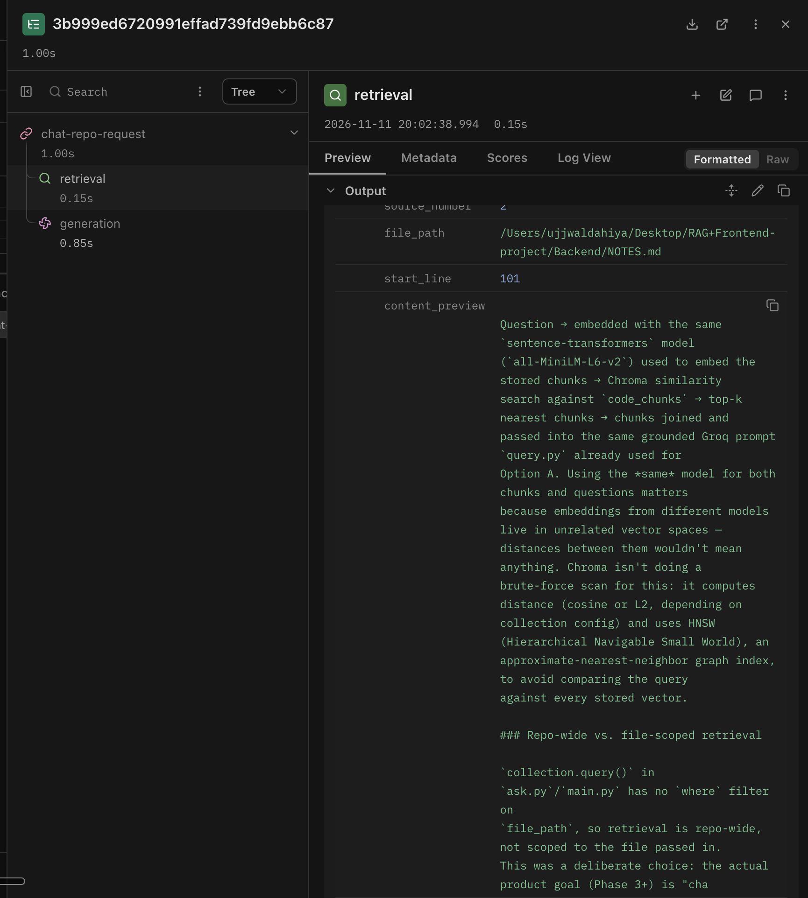
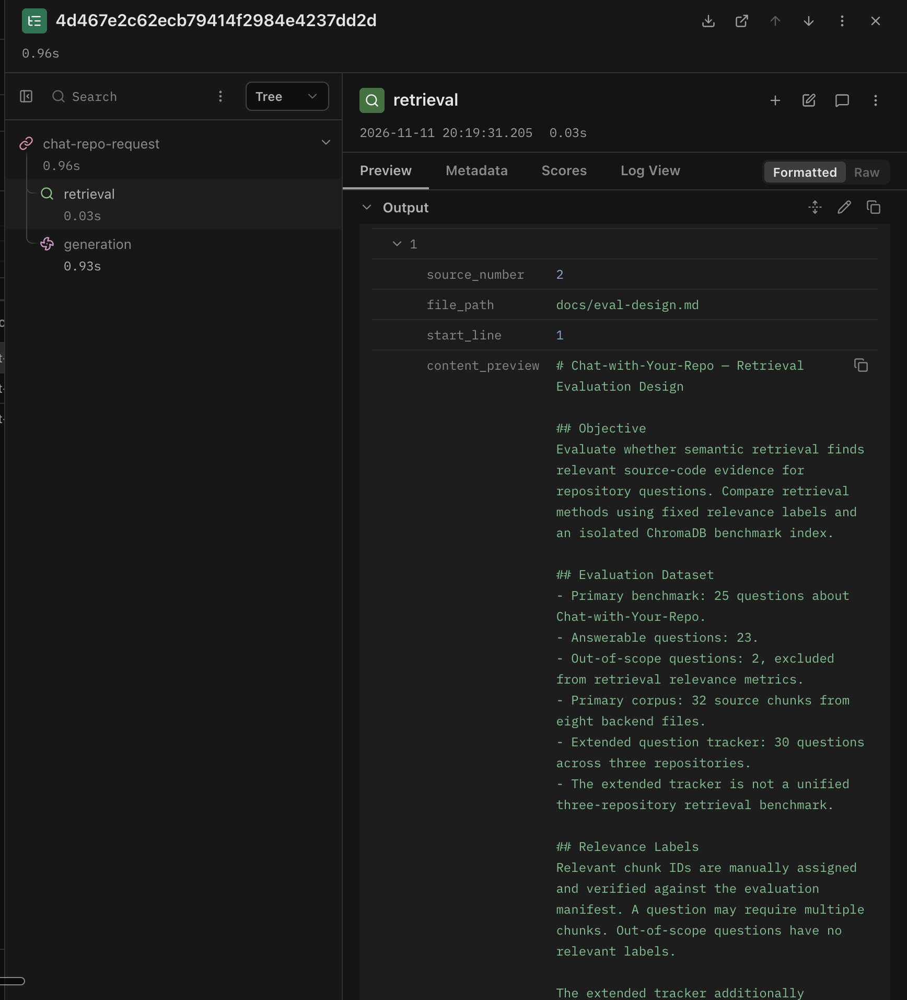

# Chat with Your Repo

A RAG-powered tool that lets you ask natural-language questions about
a codebase and get grounded, cited answers — pointing to the exact
file and line the answer came from.


## Recorded Demo

https://github.com/user-attachments/assets/d50acb6d-7524-405c-8769-e92f8e65d33e


## What it does

Paste a GitHub repo URL. The app clones the repo, splits source files into chunks using function and class boundaries for Python, then embeds and indexes those chunks for retrieval.

Ask a question in plain English to get a streamed answer with inline citations and links to the GitHub files and lines the app retrieved.
## Stack

**Backend:** Python, FastAPI, ChromaDB (vector storage),
sentence-transformers (`all-MiniLM-L6-v2` embeddings), Groq API
(LLaMA 3.3 70B) for generation.

**Frontend:** React, TypeScript, Vite. Server-Sent Events for
token-by-token streaming, markdown rendering with syntax-highlighted
code blocks.

## How it works

1. **Ingestion** — `/embed_repo` clones a GitHub repo, walks its file
   tree, and chunks each file: for Python, chunks are split at
   function/class definitions using the AST, not fixed-size splits.
2. **Retrieval** — each chunk is embedded and stored in ChromaDB with
   metadata (relative file path, start line, repo URL, branch). A
   question is embedded the same way and matched against stored chunks
   via similarity search.
3. **Generation** — retrieved chunks are labeled and passed to Groq's
   LLaMA 3.3 70B, which is instructed to answer only from the provided
   chunks and to cite which source(s) it used.
4. **Citations** — sources returned alongside the answer are built
   directly from retrieval metadata, not parsed from the model's own
   text — so a citation can't silently point to the wrong file or line
   even if the model's inline reference is imprecise.

## Design decisions worth knowing about

- **Chunking is AST-aware.** Python files are split at function/class
  boundaries so a chunk is a coherent unit of code, not an arbitrary
  slice.
- **Citations are deterministic, not model-generated.** The sources
  list returned to the user is built from what was actually retrieved,
  independent of what the model claims — a deliberate safeguard
  against the model's inline `(Source N)` reference hallucinating a
  file/line even when retrieval itself was correct.
- **Repo-scoped retrieval.** Since one deployment can index multiple
  repos, queries can optionally be scoped to a single `repo_url` to
  avoid cross-repo retrieval noise.
- **Streaming end to end.** Both the Groq API call and the FastAPI
  endpoint stream token-by-token via SSE, rendered incrementally in
  the React frontend rather than waiting for a full response.

## Status

- ✅ Backend: chunking, retrieval, citations, streaming — verified end
  to end against multiple real repos (single-file and multi-file,
  including subfolder paths)
- ✅ Frontend: chat UI, live streaming, clickable GitHub citations,
  markdown rendering with syntax-highlighted code blocks
- ✅ Deployment — [frontend](https://chat-with-your-repo.vercel.app)
  on Vercel and [backend API](https://chat-with-your-repo.onrender.com/docs)
  on Render Free. A public API request returned a scoped streamed answer
  and sources; the frontend displayed an answer and working GitHub source
  link. Repository embedding on Render has not been tested in this check.
- ✅ Demo index — startup loads a bundled 55-chunk snapshot of selected
  backend files, so visitors can ask about this project without first
  embedding a repository.
- ⚠️ **Known limitation (Render Free):** local Chroma changes are lost
  when the service spins down, restarts, or redeploys. Startup restores
  the bundled demo index; repositories embedded during a session are
  temporary. A first request after inactivity may take longer.
- ⚠️ Langfuse instrumentation is present, but tracing is disabled on
  the public instance until Langfuse credentials are configured.

## Running locally

**Backend:**
```
cd Backend
python -m venv venv && source venv/bin/activate
pip install -r requirements.txt
uvicorn main:app --port 8000
```

**Frontend:**
```
cd Frontend
npm install
npm run dev
```

Requires a `GROQ_API_KEY` in `Backend/.env`.

<!-- week2-evaluation-start -->

## Week 2 retrieval evaluation

### Original chunk-ID benchmark

The original benchmark used 32 chunks from eight backend files. The metrics below average the 23 answerable questions. Two additional questions were outside the indexed corpus.

| Retrieval method | Precision@5 | Recall@5 | MRR@5 |
|---|---:|---:|---:|
| Semantic | 0.252 | 0.891 | 0.812 |
| BM25 | 0.191 | 0.696 | 0.686 |
| Semantic + BM25 RRF | 0.217 | 0.761 | 0.755 |

### Source evidence on the experimental index

A separate frozen index uses token-aware structural chunks and records their source revision and line ranges. All 70 required evidence units are present across the index. A unit counts when the retrieved passages together cover its complete labeled source span. All methods below return up to five chunks for each of the 23 development questions.

| Retrieval method | Evidence units covered | Questions with all evidence | Decision |
|---|---:|---:|---|
| Semantic top five | 31/70 (44.3%) | 8/23 | Comparison baseline |
| BM25 top five | 32/70 (45.7%) | 7/23 | Keep experimental |
| RRF of semantic and BM25 top-five lists | 32/70 (45.7%) | 6/23 | Keep experimental |
| Cross-encoder reranking of semantic top 20 | 41/70 (58.6%) | 9/23 | Keep experimental |

Cross-encoder prediction added a median of 49 ms in the development run, excluding model loading and answer generation. One question requires at least nine chunks to cover all its evidence under this representation.

In a separate six-question pilot using the same `openai/gpt-oss-120b` generation settings for both methods, semantic retrieval produced two fully correct and complete answers out of four answerable cases. Reranking produced one. Both methods gave the expected refusal on both questions outside the corpus. On the branch-deletion question, the reranked answer incorrectly inferred that the repository URL scopes deletion to a branch. Keep the application retrieval baseline and retain the reranker as an experiment.

The original benchmark counts matching chunk IDs. The newer benchmark counts complete source spans and uses a different index. The six-case answer pilot uses one generation per method per question on a familiar development corpus. See the [answer-quality review](docs/WEEK2_ANSWER_QUALITY_REVIEW.md) for the scoring, timing scope, and source evidence.

<!-- week2-evaluation-end -->
## Week 5 observability and regression evidence

The `/ask` workflow is traced in Langfuse as a root `chat-repo-request`
observation with separate `retrieval` and `generation` steps. The trace
records repository scope, retrieved source previews, model, latency, output,
and technical failure category.

### Diagnosing a retrieval failure

The same question was run twice:

> How does the ask endpoint scope retrieval to a specific repository?

| Run | Repository scope | Retrieval result | Answer |
|---|---|---|---|
| Unscoped | `repo_url: null` | Mixed results from unrelated repositories and outdated notes | Incorrectly claimed that no repository filter existed |
| Scoped | `chat-with-your-repo` | `Backend/main.py` ranked first | Correctly explained the optional Chroma `where` filter |

The unscoped trace took `1.00s`: `0.15s` for retrieval and `0.85s` for
generation. The scoped trace took `0.96s`: `0.03s` for retrieval and `0.93s`
for generation. These are single local observations, not benchmark results.





The trace showed that the original failure began in retrieval. The model did
not receive the relevant `Backend/main.py` evidence, so generation relied on
irrelevant context. Once retrieval was scoped correctly, the model produced
the correct answer with source citations.

### Repository URL regression check

Repository URLs are canonicalized before creating the Chroma filter, so both
of these forms resolve to the same indexed repository:

```text
https://github.com/ujjwaldahiya399/chat-with-your-repo
https://github.com/ujjwaldahiya399/chat-with-your-repo.git
```

The first is the normal browser URL. The second is commonly used as a Git clone URL.

### Mocked AI behaviour regressions

The backend tests exercise the real `/ask` endpoint with mocked retrieval,
Groq output, and Langfuse observations. They require no API key or running
Langfuse server.

- A citation to a retrieved source succeeds. A citation such as `(Source 2)`
  when only Source 1 was retrieved produces an SSE `error` event and no
  `sources` event. Langfuse records `invalid_citation`.
- A mocked out-of-scope response preserves the exact `I don't know.` text.
  This checks the endpoint's handling of that response. The prompt still
  guides the model's decision to use the fallback.
- A mocked Groq error produces an SSE `error` event without terminating
  the request handler.
- The existing tests cover `.git` URL normalization and rejection of
  non-GitHub repository URLs.

Citation validation runs after generation completes. If tokens have already
reached the browser, the frontend clears the partial answer when it receives
the error event. The check examines each `Source N` mention, including grouped
citations and Unicode spacing, and rejects numbers outside the retrieved
source list. It does not verify whether a cited chunk supports the claim.

Run the complete backend suite from `Backend`:

    python -m pytest -q tests

GitHub Actions runs the same suite on relevant pull requests and pushes to
`main`. The current backend suite has 17 passing tests. When a file in
`demo_seed.py`'s `SOURCE_FILES` changes, regenerate the bundle with
`cd Backend && python demo_seed.py`; the seed freshness test detects stale
source text.

## Week 6 claim-faithfulness evaluation

Week 6 tested a narrower question than citation formatting: whether each
factual claim in an answer is supported by the retrieved code. The evaluation
froze `karpathy/micrograd` at commit `7bc720e9` and stored the exact source
snapshot, questions, retrieved contexts, raw answers, and manual annotations.

### Pilot and untouched holdout

The 10-question pilot contained eight answerable and two unanswerable cases.
After correcting one manual label, 42 of 43 factual claims were supported,
seven of eight answerable responses were fully faithful, and both
unanswerable questions returned the exact fallback.

The separate 12-question holdout contained eight answerable and four
unanswerable cases. Semantic top-five retrieval found all required evidence
for six of eight answerable questions.

| Holdout measure | Semantic baseline | AST-expanded development run |
|---|---:|---:|
| Required-evidence retrieval | 6/8 | 8/8 |
| Supported factual claims | 52/58 (89.7%) | 57/59 (96.6%) |
| Citation coverage | 46/58 (79.3%) | 55/59 (93.2%) |
| Fully faithful answerable responses | 4/8 | 6/8 |
| Exact refusals | 4/4 | 4/4 |
| Correct overall outcomes | 8/12 | 10/12 |

### AST relationship retrieval

Semantic results remain the ordered seeds. For indexed Python chunks, the
retriever parses an abstract syntax tree, finds references to indexed
top-level class and function definitions, and inserts related chunks
breadth-first for up to two hops. The final context remains limited to the
requested `top_k`, normally five chunks. Repository and branch metadata keep
relationships within the same indexed scope.

The API and CLI use the same helper. Retrieval traces record whether a chunk
came from semantic search or an AST relationship and record its relationship
depth. Non-Python chunks remain valid semantic results, and unparseable Python
falls back safely without breaking retrieval.

The production helper reproduced the saved AST-expanded selection on all 12
holdout questions. It recovered the missing evidence for H02 and H05 while
keeping five final chunks. On the 13-chunk micrograd index, helper overhead was
1.44 ms median and 2.27 ms at the slowest observed call.

### Interpretation and limitations

The AST-expanded results are post-hoc development results. The strategy was
selected after inspecting two holdout failures, so the improved numbers are
not a fresh independent holdout result. The relationship resolver is
name-based, supports top-level Python definitions, and may create ambiguous
links when different files define the same name. It also reads and parses the
scoped index for each question; the small micrograd timing does not establish
large-repository scalability.

Better evidence retrieval also does not guarantee a faithful answer. One
expanded-run claim remained contradicted: repeated backward calls increased a
gradient linearly, while the answer said it doubled each time. A future
independent evaluation should test transfer to another repository and measure
larger-index latency before broader production claims are made.
